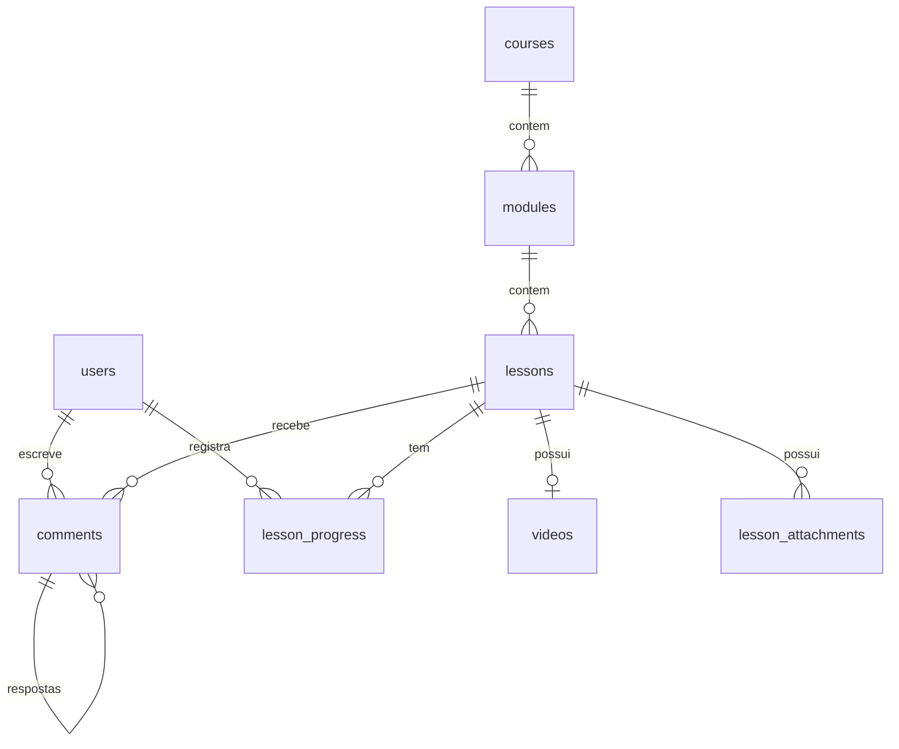

# 2. Modelo de Domínio

## 2.1 Diagrama ER

## 2.2 Tabelas

Convenções: chaves `bigint` auto-incremento, `timestamps()` em todas, nomes em inglês, enums PHP com chaves TitleCase armazenados como `string`.

### users (starter kit + alterações)

| Coluna     | Tipo           | Observação                                         |
| ---------- | -------------- | -------------------------------------------------- |
| role       | string         | `UserRole`: `admin`, `student` (default `student`) |
| blocked_at | timestamp null | Usuário bloqueado quando preenchido                |

### courses

| Coluna       | Tipo           | Observação                                |
| ------------ | -------------- | ----------------------------------------- |
| title        | string(150)    |                                           |
| slug         | string unique  | Usado na URL                              |
| summary      | string(300)    | Texto do card                             |
| description  | text null      | Markdown simples                          |
| cover_path   | string null    | Caminho no MinIO                          |
| status       | string         | `PublicationStatus`: `draft`, `published` |
| published_at | timestamp null |                                           |
| position     | unsigned int   | Ordem no catálogo                         |

### modules

| Coluna    | Tipo         | Observação                     |
| --------- | ------------ | ------------------------------ |
| course_id | fk cascade   |                                |
| title     | string(150)  |                                |
| position  | unsigned int | Índice `(course_id, position)` |

### lessons

| Coluna      | Tipo         | Observação                                                   |
| ----------- | ------------ | ------------------------------------------------------------ |
| course_id   | fk cascade   | Desnormalizado: slug único por curso e consultas do catálogo |
| module_id   | fk cascade   |                                                              |
| title       | string(150)  |                                                              |
| slug        | string       | Único por curso (índice `(course_id, slug)`)                 |
| description | text null    | Markdown simples                                             |
| status      | string       | `PublicationStatus`                                          |
| position    | unsigned int | Índice `(module_id, position)`                               |

### videos

| Coluna                               | Tipo                 | Observação                                                            |
| ------------------------------------ | -------------------- | --------------------------------------------------------------------- |
| lesson_id                            | fk cascade unique    | 1:1 com a aula                                                        |
| uuid                                 | uuid unique          | Prefixo das chaves no MinIO                                           |
| status                               | string               | `VideoStatus`: `uploading`, `queued`, `processing`, `ready`, `failed` |
| original_path                        | string null          | `videos/{uuid}/original.{ext}`                                        |
| original_size                        | unsigned bigint null | bytes                                                                 |
| upload_id                            | string null          | ID do multipart upload S3 em andamento                                |
| playlist_path                        | string null          | `videos/{uuid}/hls/master.m3u8`                                       |
| renditions                           | json null            | `[{"height":720,"bitrate":2800000,"playlist":"720p.m3u8"}]`           |
| duration_seconds                     | unsigned int null    | via ffprobe                                                           |
| thumbnail_path                       | string null          | Poster gerado no encoding                                             |
| error_message                        | text null            | Último erro                                                           |
| processing_started_at / processed_at | timestamp null       |                                                                       |

### lesson_attachments

| Coluna        | Tipo            | Observação                       |
| ------------- | --------------- | -------------------------------- |
| lesson_id     | fk cascade      |                                  |
| kind          | string          | `AttachmentKind`: `image`, `pdf` |
| path          | string          | `attachments/{uuid}.{ext}`       |
| original_name | string          | Nome exibido e usado no download |
| mime_type     | string          |                                  |
| size          | unsigned bigint | bytes                            |
| position      | unsigned int    |                                  |

### comments

| Coluna     | Tipo            | Observação                                                     |
| ---------- | --------------- | -------------------------------------------------------------- |
| lesson_id  | fk cascade      |                                                                |
| user_id    | fk cascade      |                                                                |
| parent_id  | fk null cascade | Só pode apontar para comentário raiz                           |
| body       | text            | 1–2000 caracteres                                              |
| edited_at  | timestamp null  |                                                                |
| deleted_at | soft delete     | Raiz excluída com respostas aparece como "comentário removido" |

### lesson_progress

| Coluna                | Tipo           | Observação                   |
| --------------------- | -------------- | ---------------------------- |
| user_id               | fk cascade     | Único `(user_id, lesson_id)` |
| lesson_id             | fk cascade     |                              |
| last_position_seconds | unsigned int   |                              |
| completed_at          | timestamp null |                              |

### Tabelas do starter kit a remover

`teams`, `memberships`, `team_invitations` e todo o código de Teams (models, controllers, páginas, testes) — o domínio não usa times. A remoção é a primeira tarefa da Fase 0.

## 2.3 Regras de negócio

1. **Visibilidade para aluno**: curso `published` **e** aula `published` **e** vídeo `ready`. Caso contrário, 404.
2. **Publicar aula** exige vídeo `ready`. Se o vídeo for substituído, a aula continua publicada servindo o vídeo antigo até o novo ficar `ready` (troca atômica do `uuid`); o antigo é apagado em seguida.
3. **Catálogo** mostra apenas cursos publicados com ≥ 1 aula visível.
4. **Ordenação**: `position` é reescrita em lote dentro de transação ao reordenar.
5. **Exclusão** de curso/módulo/aula/vídeo/anexo dispara job `DeleteStoragePrefix` para remover arquivos do MinIO após o commit.
6. **Progresso**: concluída quando `last_position_seconds >= 0.9 × duration_seconds` ou marcação manual. % do curso = aulas visíveis concluídas / aulas visíveis.
7. **Comentários**: resposta só a comentário raiz; editar/excluir só o autor; Admin exclui qualquer um.
8. **Usuário bloqueado**: login negado e sessões invalidadas no próximo request (middleware).
9. **Sempre existe ≥ 1 Admin**; admin não altera o próprio papel nem se bloqueia.

## 2.4 Autorização

Implementada com **Policies** e um middleware `EnsureUserIsAdmin` no grupo de rotas `/admin`.

| Ação                                          |    Aluno     |         Admin          |
| --------------------------------------------- | :----------: | :--------------------: |
| Ver catálogo / curso / aula visível           |      ✅      |           ✅           |
| Ver curso/aula em rascunho (pré-visualização) |      ❌      |           ✅           |
| Baixar anexo / obter stream de aula visível   |      ✅      |           ✅           |
| Salvar progresso próprio                      |      ✅      |           ✅           |
| Criar comentário / responder                  |      ✅      |           ✅           |
| Editar comentário                             | só o próprio |      só o próprio      |
| Excluir comentário                            | só o próprio |        qualquer        |
| CRUD cursos, módulos, aulas, vídeos, anexos   |      ❌      |           ✅           |
| Gerenciar usuários                            |      ❌      | ✅ (exceto a si mesmo) |
