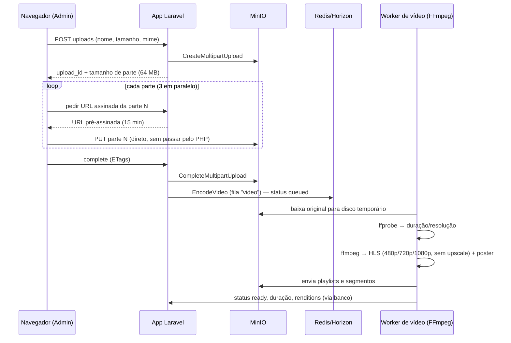

# 3. Arquitetura

## 3.1 Stack

| Camada                         | Tecnologia                                                                                   |
| ------------------------------ | -------------------------------------------------------------------------------------------- |
| Backend                        | PHP 8.5, Laravel 13, Fortify                                                                 |
| Frontend                       | Vue 3 + TypeScript, Inertia v3, Tailwind 4, componentes shadcn-vue do starter kit, Wayfinder |
| Player                         | hls.js (dependência nova)                                                                    |
| Banco                          | PostgreSQL 17                                                                                |
| Cache / filas / sessão / locks | Redis 7 + Laravel Horizon (dependência nova)                                                 |
| Arquivos                       | MinIO via disco `s3` (`league/flysystem-aws-s3-v3`, dependência nova)                        |
| Vídeo                          | FFmpeg / ffprobe (binários na imagem do worker), executados via `Process` do Laravel         |
| E-mail                         | SMTP                                                                                         |
| Testes                         | Pest 5 + Pest Browser (Playwright), Larastan nível 7, Pint, `vp check`, `vue-tsc`            |

## 3.2 Organização do código

Segue a estrutura padrão do Laravel/starter kit, sem pastas base novas:

```
app/
  Actions/            # Ações de domínio (ex.: PublishLesson, ReorderModules, StartVideoUpload)
  Enums/              # UserRole, PublicationStatus, VideoStatus, AttachmentKind
  Http/
    Controllers/
      Admin/          # CourseController, ModuleController, LessonController, VideoUploadController, ...
      CatalogController, CourseController, LessonController, CommentController, LessonProgressController, MediaController
    Middleware/       # EnsureUserIsAdmin, EnsureUserIsNotBlocked
    Requests/         # Form Requests (validação em pt-BR)
  Jobs/               # EncodeVideo, DeleteStoragePrefix
  Models/
  Policies/
  Services/Video/     # FfmpegCommandBuilder, HlsEncoder, VideoProbe
resources/js/pages/
  catalog/  courses/  lessons/  admin/{courses,modules,lessons,users,comments}/
lang/pt_BR/           # validation.php, auth.php, passwords.php, pagination.php
```

## 3.3 Rotas principais

| Método            | URI                                            | Descrição                                                |
| ----------------- | ---------------------------------------------- | -------------------------------------------------------- |
| GET               | `/`                                            | Landing (visitante) / redireciona para catálogo (logado) |
| GET               | `/cursos`                                      | Catálogo                                                 |
| GET               | `/cursos/{course:slug}`                        | Página do curso                                          |
| GET               | `/cursos/{course:slug}/aulas/{lesson:slug}`    | Página da aula                                           |
| GET               | `/aulas/{lesson}/stream/{file}`                | Playlist HLS reescrita com URLs assinadas                |
| GET               | `/anexos/{attachment}`                         | Redireciona para URL assinada                            |
| PUT               | `/aulas/{lesson}/progresso`                    | Salva posição / conclusão                                |
| POST/PATCH/DELETE | `/aulas/{lesson}/comentarios[/{comment}]`      | Comentários                                              |
| —                 | `/admin/...`                                   | CRUDs administrativos (middleware `admin`)               |
| POST              | `/admin/aulas/{lesson}/video/uploads`          | Inicia multipart upload                                  |
| POST              | `/admin/aulas/{lesson}/video/uploads/parts`    | Assina URLs das partes                                   |
| POST              | `/admin/aulas/{lesson}/video/uploads/complete` | Conclui upload e enfileira encoding                      |

Rotas com nomes; frontend consome via Wayfinder (`@/actions`, `@/routes`).

## 3.4 Pipeline de vídeo



### Detalhes

- **Upload direto ao MinIO** evita limites de upload do PHP/Traefik e não ocupa workers web. Usa o endpoint público do MinIO **`https://storage.ichatbot.com.br`**, com CORS liberado para `https://academy.sempertechnology.com.br` (métodos `PUT`, `GET`, `HEAD`; expõe o header `ETag`).
- **Encoding**: um único comando FFmpeg gera todas as renditions (`-filter_complex split` + `-var_stream_map`), H.264 (`libx264 -preset veryfast`, CRF-limitado) + AAC 128k, segmentos de 6 s, `master.m3u8`. Renditions acima da resolução original são descartadas.
- **Escada**: 480p (0,8 Mbps), 720p (2,0 Mbps), 1080p (3,5 Mbps) — tetos (`-maxrate`) com CRF 23; conteúdo de tela/slides costuma ficar bem abaixo. Ver estimativa de disco em [Infraestrutura §4.7](04-infraestrutura.md#47-capacidade-da-vps).
- **Job `EncodeVideo`**: fila `video`, `timeout` 2 h (vídeo de 1 h com 2 vCPUs leva ~30–60 min), `tries` 2, `ShouldBeUnique` por vídeo, `failed()` grava `error_message` e status `failed`. Disco temporário em volume dedicado, limpo no `finally`.
- **Worker**: serviço Swarm separado, 1 réplica, `queue:work`/Horizon supervisor só da fila `video`, `-threads` do FFmpeg e `limits.cpus` do Swarm limitados para não afetar os outros apps da VPS.
- **Original**: política definida em [Pendências](07-pendencias.md) (manter para reprocessar × apagar após encoding para poupar disco).

### Reprodução protegida

- Bucket **privado**. O player pede `/aulas/{lesson}/stream/master.m3u8`; o Laravel autoriza (policy) e devolve a playlist reescrita, onde cada playlist de variante aponta de novo para o Laravel e cada **segmento** é uma URL pré-assinada do MinIO (TTL 2 h). Segmentos vão direto do MinIO ao navegador — o PHP só serve texto pequeno.
- Playlists cacheadas no Redis por vídeo (conteúdo bruto); só a assinatura é gerada por requisição.
- Proteção é contra acesso não autenticado/compartilhamento de link; não é DRM.

## 3.5 Armazenamento (MinIO)

Bucket `academy` (privado):

```
covers/{uuid}.{ext}
attachments/{uuid}.{ext}
videos/{uuid}/original.{ext}
videos/{uuid}/poster.jpg
videos/{uuid}/hls/master.m3u8
videos/{uuid}/hls/{480p|720p|1080p}.m3u8
videos/{uuid}/hls/{480p|720p|1080p}_{n}.ts
```

- Capas e anexos: upload pelo Laravel (arquivos pequenos), servidos por `temporaryUrl()`.
- Lifecycle no bucket: abortar multipart uploads incompletos após 2 dias.

## 3.6 Filas e agendamento

Tamanho de parte do upload: 64 MB (vídeo de 2 GB = 32 partes).

| Fila      | Jobs                                                | Onde roda              |
| --------- | --------------------------------------------------- | ---------------------- |
| `default` | e-mails (verificação, reset), `DeleteStoragePrefix` | serviço `horizon`      |
| `video`   | `EncodeVideo`                                       | serviço `video-worker` |

Scheduler (`schedule:work` em serviço próprio): `horizon:snapshot`, limpeza de uploads abandonados (`videos` em `uploading` há > 48 h), `queue:prune-failed`.

## 3.7 Segurança

- HTTPS fim a fim pelo Traefik; `TrustProxies` configurado; cookies `secure`, `SESSION_DRIVER=redis`.
- Rate limiting: login (Fortify), cadastro, comentários (10/min), assinatura de partes de upload.
- Validação de MIME real (não só extensão) para capas e anexos; vídeo validado pelo ffprobe no worker.
- Markdown renderizado no servidor com HTML desabilitado (`Str::markdown` com `html_input => strip`).
- Horizon acessível apenas a Admin.
- Headers: CSP básica, `X-Frame-Options`, `Referrer-Policy` via middleware.

## 3.8 Frontend

- Reaproveita layouts, componentes e a página de **Aparência** (claro/escuro/sistema) do starter kit.
- Textos da interface escritos em pt-BR; `lang/pt_BR` para mensagens do Laravel; `APP_LOCALE=pt_BR`.
- Formulários com `<Form>`/`useForm` do Inertia; navegação com `<Link>` e prefetch nas listas.
- Contadores de catálogo como props normais; comentários como **deferred props** com skeleton; "carregar mais" com **infinite scroll/merge props**.
- Status do vídeo no admin atualizado por **polling** do Inertia enquanto `queued`/`processing`.
- Progresso enviado com `useHttp` (sem visita Inertia).
