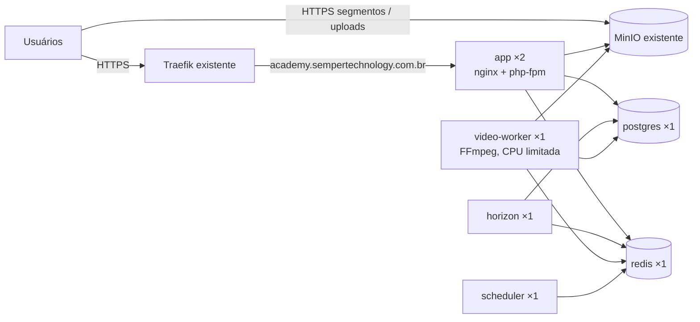

# 4. Infraestrutura

## 4.1 Visão geral (produção)



Stack Swarm: **`academy`**. Redes: `academy_internal` (overlay, privada) + `network_public` (externa, do Traefik). MinIO: `https://storage.ichatbot.com.br`, bucket `academy`. Swarm de nó único (VPS 8 GB RAM / 200 GB disco).

## 4.2 Imagem Docker

Um `Dockerfile` multi-stage com alvos:

| Alvo           | Base                                               | Uso                                                                                       |
| -------------- | -------------------------------------------------- | ----------------------------------------------------------------------------------------- |
| `vendor`       | `composer`                                         | `composer install --no-dev --optimize-autoloader`                                         |
| `assets`       | PHP CLI + Node 22                                  | `npm ci && npm run build` (Wayfinder precisa do PHP no build)                             |
| `app`          | `serversideup/php:8.5-fpm-nginx` (tag a confirmar) | Web, Horizon e scheduler; extensões `pdo_pgsql`, `redis`, `intl`, `pcntl`; OPcache ligado |
| `video-worker` | `app` + `ffmpeg`                                   | Worker de encoding                                                                        |
| `dev`          | `app` + Xdebug/pcov + Node                         | Ambiente local                                                                            |

- Imagem roda como usuário não-root; `storage` efêmero (arquivos ficam no MinIO).
- Repositório: https://github.com/BartolomeuSilva/academy
- Tags: `ghcr.io/bartolomeusilva/academy:<git-sha>` e `:latest`; o deploy sempre usa o SHA.
- Entrypoint: converte variáveis `*_FILE` (Docker secrets) em env; no serviço `app` executa `php artisan migrate --force --isolated` e `optimize` antes de subir.

## 4.3 Ambiente local

O PHP e o Node rodam na máquina (`composer run dev`); o `compose.yaml` sobe os serviços de apoio com portas que não conflitam com outros projetos:

| Serviço                                         | Imagem               | Porta local                 |
| ----------------------------------------------- | -------------------- | --------------------------- |
| Postgres (bancos `academy` e `academy_testing`) | `postgres:17-alpine` | 54320                       |
| Redis                                           | `redis:7-alpine`     | 63790                       |
| S3 (bucket `academy`, criado pelo `s3-init`)    | `rustfs/rustfs`      | 9000 (API) / 9001 (console) |
| Mailpit                                         | `axllent/mailpit`    | 11025 (SMTP) / 18025 (web)  |

> A MinIO deixou de publicar imagens Docker públicas; localmente usamos o **RustFS**, compatível com a API S3. Produção continua no MinIO existente.

```bash
docker compose up -d                  # serviços de apoio
composer setup                        # dependências, .env, migrations, build
composer run dev                      # servidor + Vite + filas
composer test                         # Pint, PHPStan, Unit + Feature (Postgres)
composer test:browser                 # testes de browser (requer npm run build)
docker compose --profile prod up -d --build   # imagem de produção em http://localhost:8080
```

O perfil `prod` sobe `app`, `horizon`, `scheduler` e `video-worker` a partir do mesmo `Dockerfile` usado no deploy — é o teste de fumaça local antes de publicar.

## 4.4 Stack de produção (`deploy/stack.yml`)

O arquivo completo está em `deploy/stack.yml`. Resumo:

```yaml
services:
    app:
        image: ghcr.io/bartolomeusilva/academy:${IMAGE_TAG}
        secrets:
            [app_key, db_password, redis_password, s3_secret, mail_password]
        environment:
            APP_ENV: production
            APP_URL: https://academy.sempertechnology.com.br
            DB_CONNECTION: pgsql
            DB_HOST: postgres
            REDIS_HOST: redis
            CACHE_STORE: redis
            SESSION_DRIVER: redis
            QUEUE_CONNECTION: redis
            FILESYSTEM_DISK: s3
            AWS_ENDPOINT: https://storage.ichatbot.com.br
            AWS_USE_PATH_STYLE_ENDPOINT: 'true'
        networks: [internal, network_public]
        healthcheck:
            test: ['CMD', 'curl', '-fsS', 'http://localhost:8080/up']
            interval: 15s
            retries: 3
            start_period: 40s
        deploy:
            replicas: 2
            update_config:
                {
                    parallelism: 1,
                    order: start-first,
                    failure_action: rollback,
                    monitor: 30s,
                }
            rollback_config: { parallelism: 1, order: start-first }
            resources: { limits: { cpus: '1.0', memory: 384M } }
            labels:
                - traefik.enable=true
                - traefik.docker.network=network_public
                - traefik.http.routers.academy.rule=Host(`academy.sempertechnology.com.br`)
                - traefik.http.routers.academy.entrypoints=<websecure>
                - traefik.http.routers.academy.tls.certresolver=<resolver>
                - traefik.http.services.academy.loadbalancer.server.port=8080

    horizon:
        image: ghcr.io/bartolomeusilva/academy:${IMAGE_TAG}
        command: ['php', 'artisan', 'horizon']
        stop_grace_period: 60s
        deploy: { replicas: 1 }

    video-worker:
        image: ghcr.io/bartolomeusilva/academy-video-worker:${IMAGE_TAG}
        command:
            [
                'php',
                'artisan',
                'queue:work',
                'redis',
                '--queue=video',
                '--timeout=7200',
                '--tries=2',
            ]
        stop_grace_period: 5m
        volumes: [video_tmp:/tmp/video]
        deploy:
            replicas: 1
            resources: { limits: { cpus: '2.0', memory: 1536M } }

    scheduler:
        image: ghcr.io/bartolomeusilva/academy:${IMAGE_TAG}
        command: ['php', 'artisan', 'schedule:work']
        deploy: { replicas: 1 }

    postgres:
        image: postgres:17-alpine
        secrets: [db_password]
        environment:
            {
                POSTGRES_DB: academy,
                POSTGRES_USER: academy,
                POSTGRES_PASSWORD_FILE: /run/secrets/db_password,
            }
        volumes: [pg_data:/var/lib/postgresql/data]
        networks: [internal]
        deploy:
            replicas: 1
            placement: { constraints: [node.role == manager] }

    redis:
        image: redis:7-alpine
        command:
            [
                'sh',
                '-c',
                'redis-server --appendonly yes --requirepass $$(cat /run/secrets/redis_password)',
            ]
        volumes: [redis_data:/data]
        networks: [internal]
        deploy: { replicas: 1 }
```

> Valores entre `<>` dependem das informações listadas em [Pendências](07-pendencias.md). Postgres e Redis **não** publicam portas e ficam só na rede interna.

## 4.5 Preparação da VPS (uma vez)

```bash
# 1. Diretório de deploy e configuração não secreta
sudo mkdir -p /opt/academy && sudo chown $USER /opt/academy
cp academy.env.example /opt/academy/academy.env   # e preencha (SMTP, Traefik)

# 2. Secrets (nunca no repositório)
php artisan key:generate --show | docker secret create academy_app_key -
openssl rand -base64 32 | tr -d '
' | docker secret create academy_db_password -
openssl rand -base64 32 | tr -d '
' | docker secret create academy_redis_password -
printf '%s' '<access-key-minio>'  | docker secret create academy_s3_key -
printf '%s' '<secret-key-minio>'  | docker secret create academy_s3_secret -
printf '%s' '<senha-smtp>'        | docker secret create academy_mail_password -

# 3. Login no GHCR (token com read:packages) para o Swarm baixar as imagens
echo '<token>' | docker login ghcr.io -u BartolomeuSilva --password-stdin

# 4. MinIO: bucket, usuário dedicado e CORS para upload direto do navegador
mc mb <alias>/academy
mc admin user add <alias> academy <secret-key-minio>
mc admin policy attach <alias> readwrite --user academy   # ou policy restrita ao bucket
mc admin config set <alias> api cors_allow_origin=https://academy.sempertechnology.com.br
```

A aplicação lê os secrets por variáveis `*_FILE` (ex.: `DB_PASSWORD_FILE`), convertidas pelo `docker/entrypoint.sh`.

No GitHub, Environment **`production`** (com revisor obrigatório) e secrets: `DEPLOY_SSH_KEY`, `DEPLOY_HOST`, `DEPLOY_USER`, `DEPLOY_KNOWN_HOSTS` (saída de `ssh-keyscan <host>`).

## 4.6 Deploy

1. Push no `main` → workflow `ci` roda todos os gates e, se verdes, publica `ghcr.io/bartolomeusilva/academy` e `academy-video-worker` com a tag do SHA.
2. Workflow `deploy` aguarda **aprovação manual** no Environment `production`.
3. Copia `deploy/stack.yml` e `deploy/deploy.sh` para `/opt/academy/` e executa `IMAGE_TAG=<sha> bash /opt/academy/deploy.sh`.
4. `deploy.sh` carrega `academy.env`, roda `docker stack deploy`, espera o serviço `app` convergir (rolling update `start-first`; healthcheck `/up`) e faz smoke test em `/up` e `/login` pela URL pública.
5. Se a atualização ou o smoke test falhar, `deploy.sh` executa `docker service rollback` em `app`, `horizon`, `scheduler` e `video-worker` e o workflow fica vermelho.

As migrations rodam no start do serviço `app` (`AUTORUN_LARAVEL_MIGRATION_ISOLATION`, com lock no Redis) e precisam ser **compatíveis com a versão anterior** (expand → contract), pois duas versões rodam juntas durante o rolling update.

## 4.7 Capacidade da VPS

VPS compartilhada com outros apps: **8 GB RAM / 200 GB disco** (vCPUs a confirmar).

### Memória (limites do Swarm)

| Serviço           | Limite                                                               |
| ----------------- | -------------------------------------------------------------------- |
| app ×2            | 2 × 384 MB                                                           |
| horizon           | 256 MB                                                               |
| scheduler         | 128 MB                                                               |
| video-worker      | 1,5 GB (FFmpeg `-threads 2`)                                         |
| postgres          | 768 MB (`shared_buffers=192MB`)                                      |
| redis             | 256 MB (`maxmemory 200mb`)                                           |
| **Total Academy** | **~3,7 GB** — sobra ~4 GB para o SO, Traefik, MinIO e os outros apps |

### Disco (estimativa por 10 min de vídeo)

| Item                        | Tetos 0,8/2,0/3,5 Mbps | Típico (aulas de tela/slides) |
| --------------------------- | ---------------------- | ----------------------------- |
| HLS (3 renditions)          | ~470 MB                | ~200 MB                       |
| Original                    | ~300 MB                | ~300 MB                       |
| **Total mantendo original** | **~770 MB**            | **~500 MB**                   |
| **Total apagando original** | **~470 MB**            | **~200 MB**                   |

Com ~100 GB livres para o Academy: **~20–35 h** de vídeo mantendo os originais, **~35–80 h** apagando-os. Disco temporário do worker: até ~6 GB durante o encoding de um vídeo de 1 h.

## 4.8 Riscos aceitos

- **Sem backup**: perda do volume `pg_data` ou do MinIO significa perda total de cursos, progresso e comentários. Recomendação mínima (fora do escopo, decisão sua): um `pg_dump` diário enviado ao MinIO, que custa ~10 linhas no scheduler.
- **Sem observabilidade**: erros só aparecem nos logs (`docker service logs academy_app`). Logs em `stderr`, formato JSON.
- **Swarm de nó único**: indisponibilidade da VPS derruba a plataforma.
- **Disco compartilhado**: vídeos crescem sem limite automático; monitorar `df -h` manualmente até existir observabilidade.
