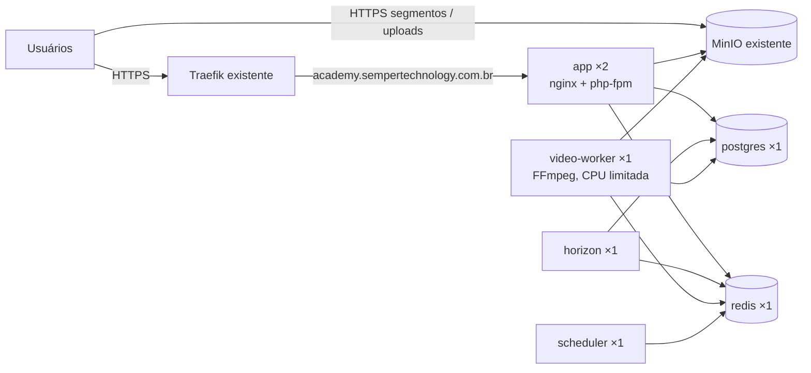

# 4. Infraestrutura

## 4.1 Visão geral (produção)



Stack Swarm: **`academy`**. Redes: `academy_internal` (overlay, privada) + `network_public` (externa, do Traefik). MinIO: `https://storage.ichatbot.com.br`, bucket `academy`. Swarm de nó único (VPS 8 GB RAM / 200 GB disco).

## 4.2 Imagem Docker

Um `Dockerfile` multi-stage com alvos:

| Alvo           | Base                                               | Uso                                                                                       |
| -------------- | -------------------------------------------------- | ----------------------------------------------------------------------------------------- |
| `vendor`       | `composer`                                         | `composer install --no-dev --optimize-autoloader`                                         |
| `assets`       | PHP CLI + Node 22                                  | `npm ci && npm run build` (Wayfinder precisa do PHP no build)                             |
| `app`          | `serversideup/php:8.5-fpm-nginx` (tag a confirmar) | Web, Horizon e scheduler; extensões `pdo_pgsql`, `redis`, `intl`, `pcntl`; OPcache ligado |
| `video-worker` | `app` + `ffmpeg`                                   | Worker de encoding                                                                        |
| `dev`          | `app` + Xdebug/pcov + Node                         | Ambiente local                                                                            |

- Imagem roda como usuário não-root; `storage` efêmero (arquivos ficam no MinIO).
- Repositório: https://github.com/BartolomeuSilva/academy
- Tags: `ghcr.io/bartolomeusilva/academy:<git-sha>` e `:latest`; o deploy sempre usa o SHA.
- Entrypoint: converte variáveis `*_FILE` (Docker secrets) em env; no serviço `app` executa `php artisan migrate --force --isolated` e `optimize` antes de subir.

## 4.3 Ambiente local

`compose.yaml` com: `app` (alvo `dev`, código montado), `vite`, `horizon`, `video-worker`, `postgres`, `redis`, `minio` + `minio-init` (cria bucket e CORS), `mailpit`.

```bash
docker compose up -d
docker compose exec app composer setup
docker compose exec app php artisan test --parallel
```

Paridade com produção: mesmas versões de Postgres, Redis, MinIO e mesma imagem base.

## 4.4 Stack de produção (`deploy/stack.yml` — esboço)

```yaml
services:
    app:
        image: ghcr.io/bartolomeusilva/academy:${IMAGE_TAG}
        secrets:
            [app_key, db_password, redis_password, s3_secret, mail_password]
        environment:
            APP_ENV: production
            APP_URL: https://academy.sempertechnology.com.br
            DB_CONNECTION: pgsql
            DB_HOST: postgres
            REDIS_HOST: redis
            CACHE_STORE: redis
            SESSION_DRIVER: redis
            QUEUE_CONNECTION: redis
            FILESYSTEM_DISK: s3
            AWS_ENDPOINT: https://storage.ichatbot.com.br
            AWS_USE_PATH_STYLE_ENDPOINT: 'true'
        networks: [internal, network_public]
        healthcheck:
            test: ['CMD', 'curl', '-fsS', 'http://localhost:8080/up']
            interval: 15s
            retries: 3
            start_period: 40s
        deploy:
            replicas: 2
            update_config:
                {
                    parallelism: 1,
                    order: start-first,
                    failure_action: rollback,
                    monitor: 30s,
                }
            rollback_config: { parallelism: 1, order: start-first }
            resources: { limits: { cpus: '1.0', memory: 384M } }
            labels:
                - traefik.enable=true
                - traefik.docker.network=network_public
                - traefik.http.routers.academy.rule=Host(`academy.sempertechnology.com.br`)
                - traefik.http.routers.academy.entrypoints=<websecure>
                - traefik.http.routers.academy.tls.certresolver=<resolver>
                - traefik.http.services.academy.loadbalancer.server.port=8080

    horizon:
        image: ghcr.io/bartolomeusilva/academy:${IMAGE_TAG}
        command: ['php', 'artisan', 'horizon']
        stop_grace_period: 60s
        deploy: { replicas: 1 }

    video-worker:
        image: ghcr.io/bartolomeusilva/academy-video-worker:${IMAGE_TAG}
        command:
            [
                'php',
                'artisan',
                'queue:work',
                'redis',
                '--queue=video',
                '--timeout=7200',
                '--tries=2',
            ]
        stop_grace_period: 5m
        volumes: [video_tmp:/tmp/video]
        deploy:
            replicas: 1
            resources: { limits: { cpus: '2.0', memory: 1536M } }

    scheduler:
        image: ghcr.io/bartolomeusilva/academy:${IMAGE_TAG}
        command: ['php', 'artisan', 'schedule:work']
        deploy: { replicas: 1 }

    postgres:
        image: postgres:17-alpine
        secrets: [db_password]
        environment:
            {
                POSTGRES_DB: academy,
                POSTGRES_USER: academy,
                POSTGRES_PASSWORD_FILE: /run/secrets/db_password,
            }
        volumes: [pg_data:/var/lib/postgresql/data]
        networks: [internal]
        deploy:
            replicas: 1
            placement: { constraints: [node.role == manager] }

    redis:
        image: redis:7-alpine
        command:
            [
                'sh',
                '-c',
                'redis-server --appendonly yes --requirepass $$(cat /run/secrets/redis_password)',
            ]
        volumes: [redis_data:/data]
        networks: [internal]
        deploy: { replicas: 1 }
```

> Valores entre `<>` dependem das informações listadas em [Pendências](07-pendencias.md). Postgres e Redis **não** publicam portas e ficam só na rede interna.

## 4.5 Secrets

Criados uma vez na VPS (`docker secret create`), nunca no repositório:

`academy_app_key`, `academy_db_password`, `academy_redis_password`, `academy_s3_key`, `academy_s3_secret`, `academy_mail_password`.

No GitHub (Environment `production`): `DEPLOY_SSH_KEY`, `DEPLOY_HOST`, `DEPLOY_USER`, `GHCR_PULL_TOKEN`.

## 4.6 Deploy

1. CI verde no `main` → job `deploy` aguarda **aprovação manual** no Environment `production`.
2. Build e push das imagens `academy` e `academy-video-worker` com tag do SHA.
3. SSH no manager do Swarm: `IMAGE_TAG=<sha> docker stack deploy -c stack.yml --with-registry-auth --prune academy`.
4. Swarm faz rolling update `start-first`; se o healthcheck falhar, rollback automático.
5. Smoke test pós-deploy (ver doc 5). Se falhar: `docker service rollback` em `app`, `horizon`, `scheduler` e `video-worker`.

Migrations precisam ser **compatíveis com a versão anterior** (expand → contract), pois duas versões rodam juntas durante o rolling update.

## 4.7 Capacidade da VPS

VPS compartilhada com outros apps: **8 GB RAM / 200 GB disco** (vCPUs a confirmar).

### Memória (limites do Swarm)

| Serviço           | Limite                                                               |
| ----------------- | -------------------------------------------------------------------- |
| app ×2            | 2 × 384 MB                                                           |
| horizon           | 256 MB                                                               |
| scheduler         | 128 MB                                                               |
| video-worker      | 1,5 GB (FFmpeg `-threads 2`)                                         |
| postgres          | 768 MB (`shared_buffers=192MB`)                                      |
| redis             | 256 MB (`maxmemory 200mb`)                                           |
| **Total Academy** | **~3,7 GB** — sobra ~4 GB para o SO, Traefik, MinIO e os outros apps |

### Disco (estimativa por 10 min de vídeo)

| Item                        | Tetos 0,8/2,0/3,5 Mbps | Típico (aulas de tela/slides) |
| --------------------------- | ---------------------- | ----------------------------- |
| HLS (3 renditions)          | ~470 MB                | ~200 MB                       |
| Original                    | ~300 MB                | ~300 MB                       |
| **Total mantendo original** | **~770 MB**            | **~500 MB**                   |
| **Total apagando original** | **~470 MB**            | **~200 MB**                   |

Com ~100 GB livres para o Academy: **~20–35 h** de vídeo mantendo os originais, **~35–80 h** apagando-os. Disco temporário do worker: até ~6 GB durante o encoding de um vídeo de 1 h.

## 4.8 Riscos aceitos

- **Sem backup**: perda do volume `pg_data` ou do MinIO significa perda total de cursos, progresso e comentários. Recomendação mínima (fora do escopo, decisão sua): um `pg_dump` diário enviado ao MinIO, que custa ~10 linhas no scheduler.
- **Sem observabilidade**: erros só aparecem nos logs (`docker service logs academy_app`). Logs em `stderr`, formato JSON.
- **Swarm de nó único**: indisponibilidade da VPS derruba a plataforma.
- **Disco compartilhado**: vídeos crescem sem limite automático; monitorar `df -h` manualmente até existir observabilidade.
