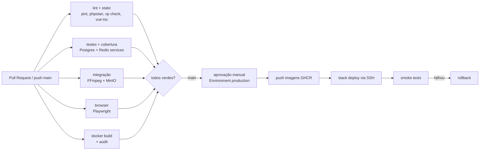

# 5. Testes e CI/CD

## 5.1 Princípio

**Nada chega à produção sem passar por todos os gates.** Toda história do PRD tem testes que cobrem seus critérios de aceite; todo bug corrigido ganha um teste de regressão.

## 5.2 Pirâmide de testes

| Tipo | Ferramenta | O que cobre | Exemplos |
|------|-----------|-------------|----------|
| **Unit** | Pest | Lógica pura, sem framework/IO | `FfmpegCommandBuilder` gera escada sem upscale; cálculo de % de progresso; reescrita de playlist HLS |
| **Feature** | Pest + `RefreshDatabase` | HTTP, validação, autorização, jobs, policies | Aluno recebe 404 em aula rascunho; admin publica aula sem vídeo → erro; comentário em resposta → 422; rate limit de comentários |
| **Integração** | Pest (grupo `integration`) | FFmpeg real e MinIO real | Encoding de um vídeo de 3 s gera `master.m3u8` + 2 renditions; multipart upload completo no MinIO |
| **Browser (E2E)** | Pest Browser (Playwright) | Fluxos críticos no navegador real, temas e mobile | Cadastro → verificação → catálogo; admin cria curso, envia vídeo, publica; aluno assiste, retoma posição, comenta; `assertNoJavaScriptErrors`, `assertNoAccessibilityIssues` em claro e escuro |
| **Smoke (pós-deploy)** | script no CI | Produção responde | `/up` 200, login page 200, versão servida = SHA |

### Regras
- Factories com states para todos os models (`Course::factory()->published()`, `Video::factory()->ready()`, `User::factory()->admin()`).
- `Storage::fake('s3')`, `Queue::fake()`, `Mail::fake()` nos testes de feature; serviços reais só nos de integração.
- Testes rodam em **PostgreSQL** (não SQLite) para paridade com produção.
- Cobertura mínima de **80%** (`--coverage --min=80`), medida no CI.
- Fixture de vídeo minúscula versionada em `tests/Fixtures/` (< 500 KB).

## 5.3 Quality gates

| Gate | Comando | Falha quando |
|------|---------|--------------|
| Estilo PHP | `vendor/bin/pint --test` | Qualquer arquivo fora do padrão |
| Análise estática PHP | `vendor/bin/phpstan analyse` (nível 7) | Qualquer erro |
| Lint/format JS | `npm run check` | Qualquer erro |
| Tipos TS/Vue | `npm run types:check` | Qualquer erro |
| Testes + cobertura | `php artisan test --parallel --coverage --min=80` | Teste falhando ou cobertura < 80% |
| Integração | `vendor/bin/pest --group=integration` | Teste falhando |
| Browser | `vendor/bin/pest tests/Browser --parallel` | Teste falhando |
| Build da imagem | `docker build --target app` e `--target video-worker` | Build falhando |
| Auditoria de dependências | `composer audit` e `npm audit --audit-level=high` | Vulnerabilidade alta/crítica |

## 5.4 Fluxo Git

- `main` protegida: merge só via Pull Request com CI verde; sem push direto.
- Branches `feat/…`, `fix/…`; commits pequenos; PR referencia a história (ex.: `US-12`).
- Dependabot (já configurado) para Composer, npm, GitHub Actions e Docker.

## 5.5 Pipeline GitHub Actions

- `.github/workflows/ci.yml`: roda em todo PR e push no `main` (substitui o `tests.yml` atual, mantendo PHP 8.5 e Node 22 e as actions fixadas por SHA).
- `.github/workflows/deploy.yml`: `workflow_run` do CI concluído com sucesso no `main` + Environment `production` com revisor obrigatório.
- Cache de Composer, npm, browsers do Playwright e camadas Docker (`type=gha`).

## 5.6 Checklist "pronto para publicar"

- [ ] Critérios de aceite da história cobertos por testes
- [ ] Todos os gates verdes no PR
- [ ] Migrations compatíveis com a versão anterior
- [ ] Testado manualmente no ambiente local (Docker) em tema claro e escuro e em mobile
- [ ] Aprovação manual do deploy
- [ ] Smoke test pós-deploy verde
